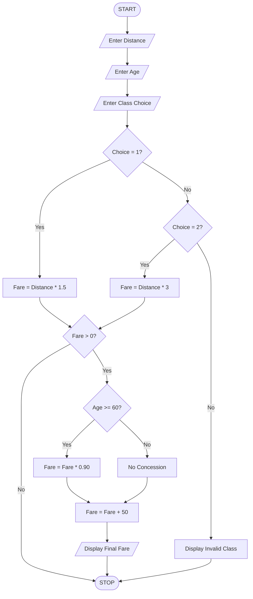

Here is the flowchart in a simple format that you can copy and draw in your assignment.

### Railway Fare Calculator – Flowchart

Flowchart symbols to use when drawing:

| Symbol        | Purpose               |
| ------------- | --------------------- |
| Oval          | Start / Stop          |
| Parallelogram | Input / Output        |
| Rectangle     | Calculation / Process |
| Diamond       | Decision              |

You can use this flowchart directly as a reference for drawing it neatly in your record book.
